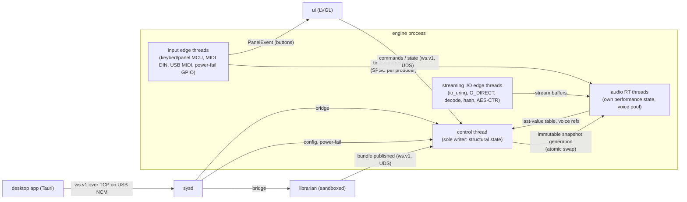
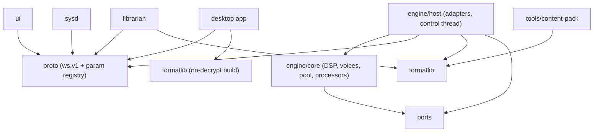
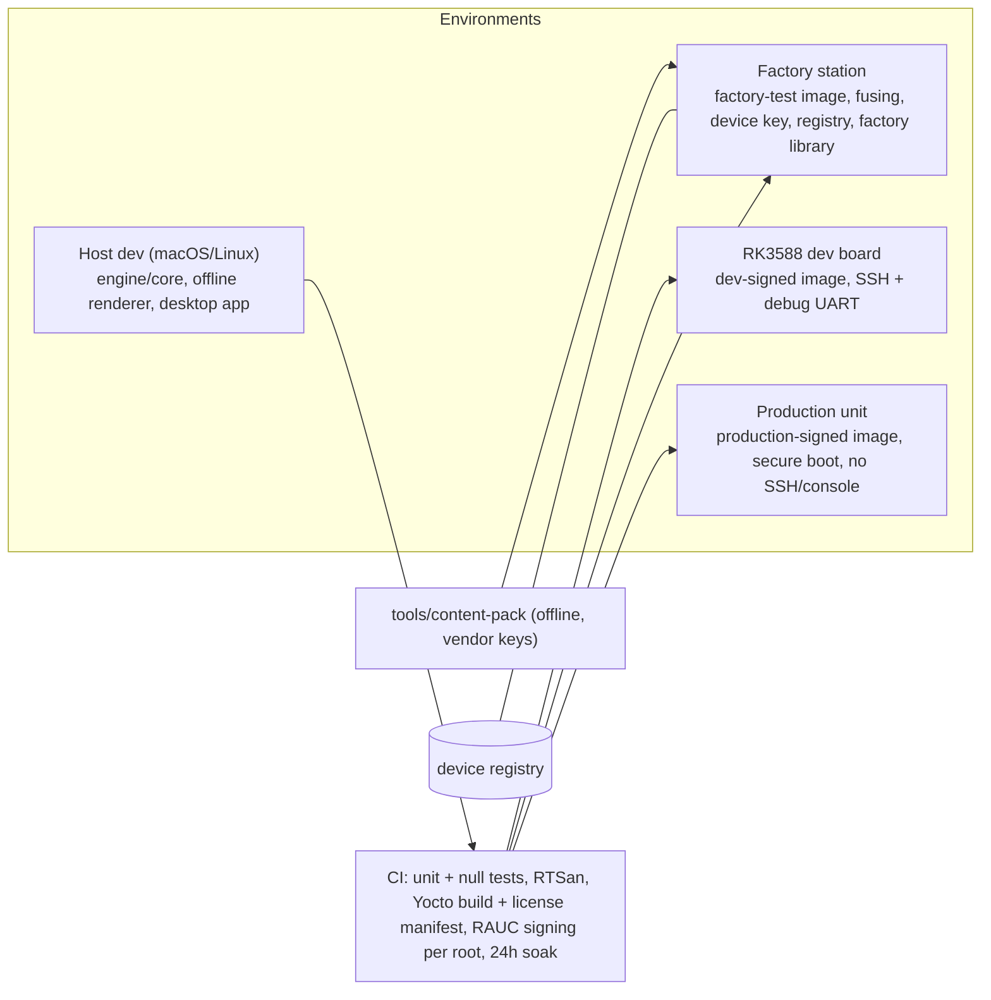

# Architecture Spine — ARM64 Stage Workstation

## Design Paradigm

The paradigm is a **single-writer control plane over a realtime data plane**:

- The device runs four actor-style processes that talk only through messages.
- Inside `engine`, one non-realtime **control thread** is the only writer of structural state.
- The **audio RT threads** own the live performance state. They take immutable snapshots and timestamped events from lock-free queues.
- **Edge threads** (input readers, streaming I/O) run at RT priority but are a separate class: they may make syscalls and are the only threads that touch devices or disk.
- The engine core is **hexagonal**: DSP, voices, pool and event processors depend only on ports, and every OS or hardware concern is an adapter.



## Invariants & Rules



Dependencies point downward only. `engine/core` depends on nothing but `ports`. Nothing depends on `ui`, `desktop` or `tools`.

### AD-1 — Single writer of structural state [ADOPTED]

- **Binds:** CAP-3, CAP-7, CAP-12, CAP-19, all clients
- **Prevents:** two owners of patch state; a UI crash losing sound; clients racing each other's edits
- **Rule:**
  - Structural state is written only by the engine control thread. It covers Live Sets ("programs"), parts, splits, scenes, setlists and ASSIGN maps (AD-31), routing (AD-28), processor settings (AD-21) and save.
  - Clients only send commands.
  - The control thread hands state to the RT threads only as immutable snapshot generations, swapped with an atomic pointer (lifetimes per AD-23).

### AD-2 — Performance state and the parameter registry [ADOPTED]

- **Binds:** CAP-2, CAP-4, CAP-13, CAP-18, CAP-19
- **Prevents:** one parameter with two owners; a program swap silently resetting live knobs; saving stale values
- **Rule:**
  - A generated parameter registry in `proto/` gives every `param_id` exactly one class: structural or performance.
  - Performance parameters (notes, velocity, drawbars, knobs, pedals, pitch bend, CC, tempo) have one live value, owned by the RT threads. Every source changes them only by sending an event to the RT threads (AD-8). That includes the ui and the desktop app.
  - Snapshots carry the initial performance values tagged with `program_generation`. RT applies them only when the generation changes.
  - RT publishes a last-value table, not a lossy queue.
  - "Save" waits on a control→RT fence before it reads the table.

### AD-3 — Realtime safety

- **Binds:** CAP-1, CAP-2, CAP-3, all code on audio RT threads
- **Prevents:** dropouts from allocation, locks, blocking, I/O or page faults
- **Rule:**
  - Audio RT threads never allocate, lock, block, do I/O, or touch memory that is not mlocked and pre-faulted. Their only syscall is the ALSA period wait.
  - Cross-thread traffic uses only lock-free SPSC queues, atomic swaps and the last-value table.
  - Edge threads do all device and disk access.
  - CI runs RealtimeSanitizer on host builds.
  - The system has no swap and no core dumps.

### AD-4 — Process topology, isolation and input ownership [ADOPTED]

- **Binds:** CAP-1, CAP-8, CAP-10, CAP-14, CAP-15, CAP-16
- **Prevents:** an import crash or heavy CPU affecting sound; a non-RT relay in the note path; two processes opening one device
- **Rule:**
  - There are four systemd services: `engine`, `ui`, `librarian` and `sysd`.
  - `engine` is the only runtime owner of the audio device, the MCU links, MIDI DIN, USB MIDI (ALSA) and the power-fail GPIO, together with `sysd` (AD-18). Streaming and decryption also stay inside `engine`.
  - `sysd` never relays notes. It flashes the MCUs only before `engine` starts.
  - `librarian` runs sandboxed, at low priority, pinned off the audio cores.
  - `ui` is a client only. Panel buttons reach it as `PanelEvent` messages, and it drives the LEDs through commands to `engine`.

### AD-5 — Core allocation and block phases

- **Binds:** CAP-1, CAP-3, CAP-4, CAP-13, CAP-19
- **Prevents:** engines assuming different threading models; races on part buses; allocation during the parallel render
- **Rule:**
  - 3 Cortex-A76 cores are isolated for audio RT (`isolcpus`, `nohz_full`, fixed governor). Everything else runs on the 4th A76 and the A55 cores.
  - Each block is 64 frames at 48 kHz and runs these phases in order:
    1. **Serial:** merge events, run the event processors (AD-21), allocate and steal voices (AD-22).
    2. **Parallel:** per-part shared generators (e.g. tonewheels).
    3. **Parallel:** voice render into per-worker scratch buffers.
    4. **Barrier.**
    5. Sum, per-part FX, sends, master.

### AD-6 — Voice contract

- **Binds:** CAP-1, CAP-4, CAP-5, CAP-6
- **Prevents:** hidden shared state racing at high polyphony
- **Rule:**
  - Voice code reads the current snapshot and its part's shared-generator output. It writes only its own voice state and its worker's scratch buffer.
  - Shared per-part state is written only in phase 2 or after the barrier.

### AD-7 — Engines are static modules behind one interface [ADOPTED]

- **Binds:** CAP-4, CAP-5, CAP-6, CAP-12
- **Prevents:** a plugin ABI to version; engines allocating or stealing on their own
- **Rule:**
  - Every engine implements the single engine interface. It declares a cost per voice in cost units (CPU, stream slots) and exposes steal metadata.
  - An engine gets voices only from the pool arbiter (AD-22), which guarantees it **at least** its floor.
  - Engines are compiled into the engine binary and ship only inside the A/B image. Loadable plugins are forbidden until this AD is amended.

### AD-8 — Event format and clock domains

- **Binds:** CAP-2, CAP-10, CAP-11, CAP-18, CAP-19
- **Prevents:** per-source event shapes; reordering after hours of clock drift; flams between layered engines; applying the velocity curve twice
- **Rule:**
  - Engines consume only MIDI 2.0 UMP.
  - Device time is the SoC's `CLOCK_MONOTONIC_RAW`, in nanoseconds:
    - Input edge threads convert MCU ticks to device time, tracking offset and drift.
    - External MIDI is stamped on arrival.
  - Only the RT plane maps device time to sample frames (a DLL on the ALSA hardware pointer). Each event is applied at its exact in-block frame offset, after a fixed scheduling delay. The offline renderer uses the same mapping.
  - Keybed: the MCU sends raw per-contact times. The SoC reader applies the velocity curve exactly once. It emits a vendor per-note `contact_k` controller at each closure, then a Note On at the contact that measures velocity. The organ engine starts sound on the first contact.

### AD-9 — One writer per persistent dataset

- **Binds:** CAP-8, CAP-9, CAP-14, CAP-15, all processes
- **Prevents:** two processes writing the same file or database
- **Rule:**

| Dataset | Sole writer | Readers |
|---|---|---|
| Library bundles under `/data/lib` | librarian | engine (read-only, AD-10) |
| Catalog: search, categories, favorites and tags for libraries **and** programs (SQLite WAL) | librarian | ui, desktop, via the librarian API only |
| Setlists, Live Sets (programs) with parts, scenes and per-Live-Set ASSIGN maps, the global default ASSIGN map, setlist tags (AD-31) | engine control thread | ui, desktop, via published state |
| System config (velocity curves, calibration, MIDI, clock source) | sysd | others, at start and on change |
| Device and content keys | OP-TEE | engine, on request |

### AD-10 — Identity: libraries, bundles, instruments, programs

- **Binds:** CAP-1, CAP-8, CAP-12, CAP-14, CAP-15
- **Prevents:** a re-import silencing patches; a patch playing the wrong instrument; ID collisions across units; ID minting that needs a clock
- **Rule:**
  - **`library_id`** is stable. Factory and partner libraries carry an ID the vendor assigns. User imports get a UUIDv5 of a source fingerprint.
  - **`bundle_id`** is the manifest hash.
  - **`instrument_key`** is a deterministic function of the source: the normalized `.sfz` relative path, or the SF2 `bank:preset`.
  - Only formatlib mints these IDs.
  - The engine resolves a library only through `/data/lib/<library_id>/current → <bundle_id>/`. It has no runtime dependency on `librarian`, and paths never appear in patches.
  - A reference that does not resolve plays silent and raises "missing library/instrument". It is never substituted.
  - Locally minted program IDs are UUIDv4, since the unit has no RTC. Factory programs carry vendor IDs. An imported program whose ID collides gets a new one.

### AD-11 — Bundles: immutable, faithful, leased

- **Binds:** CAP-1, CAP-8, CAP-9, CAP-14, CAP-17
- **Prevents:** streaming a half-written or garbage-collected bundle; silent loss of fidelity; orphan bundles or catalog rows
- **Rule:**
  - Import never resamples or requantizes. Integer PCM uses the FLAC-style lossless codec, and float data is stored uncompressed.
  - `librarian` stages the bundle, verifies a bit-exact decode round-trip, fsyncs, renames it into place and flips `current`, and only then writes the catalog row. A reconcile pass at startup removes orphans.
  - A published bundle is never modified.
  - `engine` holds a `BundleLease` on every bundle that a live generation references. `librarian` deletes only bundles that no lease holds.

### AD-12 — Versions, compatibility and migration

- **Binds:** CAP-5, CAP-6, CAP-12, CAP-14, CAP-17
- **Prevents:** old patches failing on new firmware; a rollback meeting forward-migrated data; skew between the desktop app, the firmware and the MCUs
- **Rule:**
  - Every persisted or wire format carries a version: bundle `format_version`, programs, config, the catalog schema, `ws.v1` and the MCU protocol.
  - Readers accept N and N−1, and unknown fields are preserved.
  - Irreversible migrations run only after RAUC marks the new slot good.
  - Every release opens every program that any earlier release saved.

### AD-13 — One message schema and its protocol rules

- **Binds:** CAP-10, CAP-14, CAP-15, all processes, desktop app
- **Prevents:** the device UI and the desktop app diverging; request ID collisions; lost updates; an exposed USB surface
- **Rule:**
  - All IPC uses Protocol Buffers `ws.v1` over Unix domain sockets. The desktop app uses the same schema, framed on one TCP port over USB CDC-NCM and bridged by `sysd`.
  - `ws.v1` only grows by addition. Every connection starts with a version and feature handshake.
  - `request_id = (client_id, seq)`. Deltas carry `(epoch, seq)`, and edits carry `base_revision`. A stale edit is rejected.
  - On the USB network, nftables admits only that one port. Pairing requires a code shown on the device screen and typed into Velora Studio. There is no SSH in production.
  - The gadget composition is fixed: UAC2, MIDI 2.0/1.0 and NCM. Never mass storage, never a console.
  - USB-A drives are mounted read-only with `nosuid,nodev,noexec`, and only the sandboxed `librarian` parses them.

### AD-14 — Content protection and key handling

- **Binds:** CAP-9
- **Prevents:** keys on disk; plaintext vendor content on the device or on USB; a copied library playing elsewhere
- **Rule:**
  - Factory and partner bundles are made off-device by `tools/content-pack`, which applies:
    - AES-CTR per block, under a per-library content key;
    - an Ed25519-signed manifest and block hashes.
  - `librarian` only verifies and installs these bundles. It never holds content keys or plaintext vendor content.
  - Content keys are wrapped to the device key in OP-TEE. They are unwrapped into `engine` memory only while a library is loaded, and never written to disk.
  - The desktop build of formatlib has no decrypt path.
  - User imports are never encrypted.

### AD-15 — License boundary

- **Binds:** all code, the image build
- **Prevents:** a conflict between secure boot and the installation-information clauses; GPL code in closed engines
- **Rule:**
  - `INCOMPATIBLE_LICENSE` excludes GPL-3.0-only/-or-later and LGPL-3.0-only/-or-later.
  - GPL-3.0-with-GCC-exception runtimes are allowed, and so are GPLv2 kernel and BusyBox.
  - The flac/metaflac CLIs stay out of the image, and libsndfile is not enabled.
  - Engine code is clean-room or permissive. GPL software is used only as an unshipped test oracle.

### AD-16 — Physical control interface [ADOPTED]

- **Binds:** CAP-2, CAP-11, CAP-18, CAP-23
- **Prevents:** panel work disturbing keybed timing; ad-hoc protocols per board; units that cannot be fixed or are bricked by a bad flash
- **Rule:**
  - There are two MCUs: the keybed MCU (keys only, ≥10 kHz scan, per-contact times) and the panel MCU (endless encoders with LED rings, 9 dual-function faders, buttons with per-state LEDs, wheels, pedals).
  - Encoders report relative steps and never need pickup. v1 faders are non-motorized, so the ui and engine apply pickup after any recall. Motorized faders exist only on Pro (AD-27).
  - Both use the versioned frame protocol in `HARDWARE-INTERFACES.md`.
  - Each MCU has an immutable dual-bank bootloader. Its firmware ships inside the A/B image, and `sysd` reflashes it at boot only on a version mismatch.

### AD-17 — Audio clocking and output path

- **Binds:** CAP-2, CAP-10, CAP-11
- **Prevents:** jitter from the SoC PLL; USB in the critical output path
- **Rule:**
  - Main outputs leave over I2S/TDM to the codec, which is the clock master on its own 48 kHz-family crystal.
  - The USB UAC2 gadget runs in async mode with a feedback endpoint and follows the codec clock.
  - The engine never runs on the USB clock.

### AD-18 — Updates, power loss and write discipline [ADOPTED]

- **Binds:** CAP-12, CAP-16, CAP-17, CAP-20
- **Prevents:** bricked units; SSD corruption on power loss; PA pops; disk writes during a show
- **Rule:**
  - The root filesystem is read-only. RAUC A/B slots roll back on a failed boot. Data lives on a journaled partition.
  - On the power-fail GPIO (supercap hold-up), an engine edge thread fades the outputs to silence on the RT plane, and `sysd` freezes writes and flushes the NVMe.
  - During a performance the disk only reads:
    - Logs and metrics stay in RAM and are flushed at idle.
    - SQLite checkpoints and `fstrim` run only at idle.
    - Writes happen only on save (Write), import and update.
    - The one exception is the Boot-into pointer (last Live Set and scene): a tiny record, written atomically to the journaled partition on a Live Set or scene change, deferred to an idle-safe moment.

### AD-19 — Platform-independent engine core

- **Binds:** CAP-1, CAP-4, CAP-5, CAP-8, CAP-19
- **Prevents:** DSP that can only be tested on the device
- **Rule:**
  - `engine/core` has no dependency on Linux, ALSA, OP-TEE or the hardware. It builds on macOS and Linux hosts.
  - The offline renderer drives it for the null tests.

### AD-20 — Externalized strings

- **Binds:** ui, desktop app
- **Prevents:** a localization refactor before export; locales that need a new image to fix
- **Rule:**
  - No user-facing text is hard-coded. Every string is a locale-catalog key.
  - English is the source and default locale. PT-BR and ES ship in v1. Further locales arrive by system update.
  - User content (setlist, Live Set, scene and tag names) is never translated. Panel legends are English only.

### AD-21 — Event processors and the single clock

- **Binds:** CAP-19, the future Pro sequencer
- **Prevents:** the arpeggiator and the sequencer keeping separate tempos; note generators off the RT plane
- **Rule:**
  - Note-generating processors run on the RT plane, per part, in the serial phase. They consume UMP and emit timestamped UMP at sample-accurate positions. Today that is the arpeggiator; later, the sequencer.
  - Their settings and patterns are structural state (AD-1).
  - The RT plane owns exactly one tempo/transport clock. Tempo and transport are performance state. The clock source (internal, DIN or USB MIDI clock) is structural config owned by `sysd`.

### AD-22 — Voice pool arbiter

- **Binds:** CAP-3, CAP-4, CAP-13
- **Prevents:** engines stealing by their own rules; voice floors broken under CPU load; organ dropouts
- **Rule:**
  - The arbiter is the only allocator and stealer. It runs on the RT plane in the serial phase.
  - Its budget is in cost units. When a performance loads, the arbiter reserves, in this order:
    1. the FX budget;
    2. the organ and rotary reservation, which is never stolen;
    3. each engine's floor.
  - The remainder is shared.
  - Stealing considers the whole performance. It protects the lowest held note and sustained notes, and takes newer and quieter voices first.
  - A stolen voice that is still fading out keeps counting against the budget.

### AD-23 — Generations and lifetimes

- **Binds:** CAP-1, CAP-7, CAP-9
- **Prevents:** freeing a snapshot, heads or keys while held or releasing notes still use them
- **Rule:**
  - A snapshot, its resident heads and its content keys form one generation.
  - A generation is swapped in only when all of its heads are resident.
  - A generation is freed only after RT reports that no live voice references it. Its `BundleLease`s are released then.

### AD-24 — Streaming budget

- **Binds:** CAP-1, CAP-2, CAP-16
- **Prevents:** underruns on SSD tail latency; heads outgrowing RAM
- **Rule:**
  - Each head covers the qualified SSD's measured p99.99 read latency plus margin.
  - The head budget comes from the tier profile (AD-27); v1 gets 4–6 GB.
  - Reads use `O_DIRECT`. Decoding and block-hash checks happen on the I/O edge threads.
  - At boot, the engine opens the `current` links and the indexes and never scans libraries. The heads of the Boot-into target (AD-18) load first, then favorites.

### AD-25 — Provisioning and key custody

- **Binds:** CAP-9, CAP-12
- **Prevents:** units that can never receive partner content; a leaked dev key signing production; unrepairable units
- **Rule:**
  - Dev, factory-test and production signing roots are separate. The production root stays offline in an HSM.
  - At the factory station:
    - secure boot is fused;
    - OP-TEE generates the device key;
    - the device ID and public key go to the vendor registry, starting with unit #1;
    - the factory library is pre-installed, already wrapped for that device.
  - Swapping a SoM means re-provisioning and re-wrapping through the registry.
  - Anti-rollback uses an OTP version counter that is bumped only on security releases.

### AD-26 — Update delivery without radio

- **Binds:** CAP-5, CAP-6, CAP-12
- **Prevents:** competing update paths; library content travelling inside firmware
- **Rule:**
  - Signed RAUC bundles arrive only through the desktop app or a USB-A stick, and `sysd` is the only installer.
  - Library updates are new bundles installed by `librarian` (AD-11), never part of a RAUC bundle.

### AD-27 — Tier profile

- **Binds:** CAP-7, the v1/Pro single base
- **Prevents:** a v1/Pro code fork
- **Rule:**
  - At boot, a tier is read from the board ID or OTP. It sets the part count (8 or 16), the head budget, the voice and cost budgets, and the enabled modules (the sequencer is Pro only).
  - The same image runs on both tiers.

### AD-28 — Signal routing (v1)

- **Binds:** CAP-7, CAP-11, CAP-13
- **Prevents:** engines and FX assuming different bus topologies
- **Rule:**
  - The topology is fixed:
    1. a per-part insert chain;
    2. two global sends (reverb, delay);
    3. master FX;
    4. per-part assignment to main or aux outputs.
  - Line-in can be mixed into the master only.
  - Routing is structural state.

### AD-29 — Observability and release gates

- **Binds:** CAP-1, CAP-2, CAP-17, operations
- **Prevents:** shipping an image that drops audio; field issues that can't be diagnosed
- **Rule:**
  - The engine keeps an xrun counter, steal and stream-underrun counters, and a latency histogram in RAM. They are exported through the desktop app on request.
  - A release requires, in CI:
    - host unit tests and null tests;
    - RealtimeSanitizer;
    - a Yocto build with a license manifest;
    - a 24 h soak on the dev board with zero xruns.

### AD-30 — Seamless switching and preload

- **Binds:** CAP-1, CAP-16, CAP-20, CAP-21
- **Prevents:** cut or truncated notes on a scene, Live Set or setlist change; silence while a Live Set loads
- **Rule:**
  - On a Live Set change the control thread prepares the next generation (AD-23) and swaps it in only when its heads are resident. Voices started on the old generation finish on it.
  - The next Live Set of the loaded setlist is preloaded: its heads stay resident within the AD-24 head budget, so an in-setlist change swaps at once.
  - A jump to a Live Set that is not preloaded keeps the current generation playing until the target's heads are resident, then swaps. The ui shows the remaining load time.
  - Scene recall is a structural snapshot swap that changes parameters only. Scenes never change a part's instrument, so a scene recall never loads heads.
  - Loading a setlist never stops the current generation.

### AD-31 — Live Set data model ownership

- **Binds:** CAP-7, CAP-21, CAP-22, CAP-23
- **Prevents:** a second owner of setlist or ASSIGN data; backups that bypass the single writer; Live Set files a later firmware cannot open
- **Rule:**
  - Setlists, Live Sets (8 parts, up to 8 scenes, the ASSIGN map), the global default ASSIGN map and setlist tags are structural state owned by the engine control thread (AD-1, AD-9).
  - A new Live Set copies the global default ASSIGN map at creation.
  - Each persisted form, including the `.velorabackup` file, carries an AD-12 version.
  - Velora Studio backup reads published state. Restore (merge or replace) reaches the device only as control-thread commands.

## Consistency Conventions

| Concern | Convention |
| --- | --- |
| Naming | Processes `engine`, `ui`, `librarian`, `sysd`. Protobuf package `ws.v1`, with messages `PascalCase` and fields `snake_case`. C++ namespaces mirror directories |
| IDs | AD-10. All IDs are opaque strings on the wire |
| Domain terms | "Program" and "performance" in ADs mean the Live Set. User-facing text uses only Setlist, Live Set, Scene, Part, Timbre (UX `EXPERIENCE.md`) |
| Time | Device-monotonic nanoseconds (AD-8). Audio positions in frames at 48 kHz. Wall-clock time only in logs, and optional |
| Errors | `{code, message, details}` with a closed code enum in `ws.v1`. No exception crosses a process boundary |
| Commands and state | `request_id`, `(epoch, seq)` and `base_revision` per AD-13. State is published as a full snapshot on connect, then deltas |
| Logging | Structured journald messages tagged with the process name. RAM-buffered during performance (AD-18). RT threads push records to a queue drained by the control thread |
| Config | Protobuf with `schema_version`, owned by `sysd` |
| Strings | Locale-catalog keys, English source (AD-20) |

## Stack

| Name | Version |
| --- | --- |
| Linux kernel (PREEMPT_RT mainline, ALSA UMP, f_midi2/f_uac2/f_ncm) | 6.18 LTS |
| Yocto Project (`INIT_MANAGER = "systemd"`) | 6.0 "Wrynose" LTS |
| RAUC (meta-rauc `wrynose`) | ≥ 1.15.2 |
| OP-TEE | ≥ 4.9.0 |
| C++ (engine, librarian, sysd, formatlib) | C++20, Yocto 6.0 toolchain |
| LVGL (DRM/KMS) | 9.6.0 |
| Tauri (desktop app) | 2.12 |
| Protocol Buffers | 6.33.6 (Yocto 6.0) |
| SQLite | 3.51.3 (Yocto 6.0) |
| libFLAC | 1.5.0 |
| sfizz (parser vendored into formatlib; full engine only as unshipped oracle) | 1.2.3 (final, archived upstream) |
| SoC | Rockchip RK3588, 16 GB (v1) / 32 GB (Pro) |

## Structural Seed



```text
/
  proto/                 # ws.v1 schema + generated parameter registry
  engine/core/           # DSP, voices, pool arbiter, engines, event processors — no OS deps
  engine/ports/          # port interfaces
  engine/host/           # adapters: ALSA, UMP, input edge threads, io_uring streaming, OP-TEE; control thread
  formatlib/             # IDs, bundle read/write, lossless codec, crypto (decrypt excluded in desktop build), vendored SFZ parser
  librarian/             # sandboxed import, convert, index, catalog
  sysd/                  # config, power-fail, USB gadget + NCM bridge, RAUC install, MCU flashing
  ui/                    # LVGL app
  desktop/               # Tauri app (FFI to formatlib)
  mcu/keybed/ mcu/panel/ mcu/bootloader/
  tools/offline-render/  # null tests
  tools/content-pack/    # vendor bundle packing + signing
  yocto/                 # layers, images (dev/factory/prod), RAUC config
```

## Capability → Architecture Map

| Capability / Area | Lives in | Governed by |
| --- | --- | --- |
| CAP-1 streaming library | engine/host streaming, engine/core sample engine | AD-3, AD-11, AD-23, AD-24 |
| CAP-2 ≤5 ms latency | MCU → input edge thread → RT | AD-3, AD-8, AD-16, AD-17 |
| CAP-3 voice pool | engine/core arbiter | AD-5, AD-7, AD-22 |
| CAP-4/5/6 organ, FM, VA | engine/core engines | AD-6, AD-7, AD-19, AD-22 |
| CAP-7 8 parts | control thread, tier profile | AD-1, AD-27, AD-28 |
| CAP-8 SFZ/SF2 import | librarian, formatlib | AD-9, AD-10, AD-11, AD-15 |
| CAP-9 protected format | tools/content-pack, formatlib, OP-TEE | AD-14, AD-25 |
| CAP-10 USB audio/MIDI | sysd gadget, engine/host | AD-4, AD-13, AD-17 |
| CAP-11 I/O | hardware | AD-28, `HARDWARE-INTERFACES.md` |
| CAP-12 firmware engines | engine image, RAUC | AD-7, AD-12, AD-26 |
| CAP-13 effects | engine/core | AD-5, AD-22, AD-28 |
| CAP-14 transfer | librarian, sysd bridge, desktop | AD-11, AD-13 |
| CAP-15 browse | ui, librarian catalog | AD-9, AD-10 |
| CAP-16 boot ≤10 s to Boot-into target | sysd, engine start | AD-4, AD-18, AD-24 |
| CAP-17 power loss | sysd, RAUC, librarian | AD-11, AD-12, AD-18 |
| CAP-18 keybed expression | keybed MCU, input edge thread, organ | AD-8, AD-16 |
| CAP-19 arpeggiator | engine/core event processors | AD-2, AD-8, AD-21 |
| CAP-20 seamless switching | control thread, engine/host streaming | AD-23, AD-24, AD-30 |
| CAP-21 setlists, Live Sets, scenes | control thread, ui | AD-1, AD-9, AD-30, AD-31 |
| CAP-22 backup and restore | desktop, sysd bridge, control thread | AD-12, AD-13, AD-31 |
| CAP-23 ASSIGN knobs | panel MCU, control thread, RT | AD-2, AD-16, AD-31 |

## Open Questions

| Question | Blocks | Resolve by |
| --- | --- | --- |
| Secure-boot chain on mainline RK3588: barebox (`rksecure`) or U-Boot plus Rockchip tools; the TF-A source; an OP-TEE hardware unique key implementation | AD-14, AD-25 in production (not engine work) | Milestone-1 spike. Exit criterion: a fused dev board boots a signed image and derives a per-device key |
| PREEMPT_RT latency on RK3588 under load | AD-5, CAP-2 | Milestone-1 spike: cyclictest/rtla with streaming + render load. The CM5/Intel fallback applies if it fails |
| Hardware bring-up: USB peripheral role in the device tree, I2S MCLK gating by boot firmware, PCM3168A in TDM, UAC2 + MIDI 2.0 + NCM composite on macOS/Windows/Linux | AD-17, CAP-10 | First prototype board |

## Deferred

| Item | Revisit when |
| --- | --- |
| MCU family | Partners choose by month 7. Any family that meets AD-16 and `HARDWARE-INTERFACES.md` is fine |
| Partner licensing server and activation flow | After v1 launch. AD-14 and AD-25 already provide the registry and wrapping |
| Pro sequencer internals | After v1. It is an AD-21 processor and an AD-1 client |
| Sampling feature, line-in into engines | Post-launch or Pro (AD-28 allows line-in to master only) |
| Locales beyond EN, PT-BR, ES | Delivered by system update when a market needs them |
| Kernel LTS migration (6.18 EOL ≈ Dec 2027) | 6 months before EOL: move to the next LTS with a full RT soak |
| Lossless float codec | When float sources exceed 20% of library size |
| Multi-library dedup and storage quotas | When test libraries exceed 500 GB |
