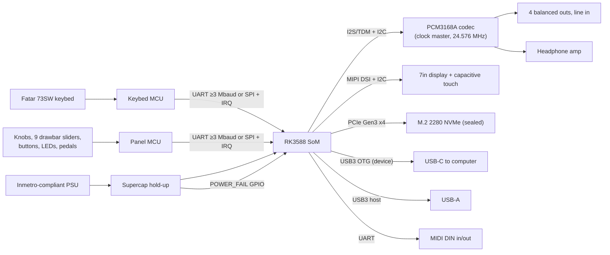

# Hardware Interfaces — what the software expects from the boards

Audience: the hardware partners building the v1 boards. This document is the binding contract behind AD-16, AD-17, AD-18, AD-25 and AD-27 of `ARCHITECTURE-SPINE.md`. "Must" means software depends on it, and "should" is a strong preference.

## 1. System overview

## 2. SoM and board

- Rockchip RK3588 on an **industrial SoM** with a **written longevity commitment of 7–10 years**. v1 has 16 GB of RAM and Pro has 32 GB, pin-compatible.
- **No radio**: no Wi-Fi or Bluetooth on the SoM variant, and no RF parts on the carrier.
- **Tier ID strap** (GPIO or EEPROM) readable at boot, distinguishing v1 from Pro (AD-27).
- The SoM BSP must support mainline Linux 6.18 LTS. The vendor-kernel-only parts must not be the audio, USB, PCIe or display paths.
- **Thermal:** 24 h at full audio load (3 A76 cores at 100%) without throttling, in a closed chassis at 40 °C ambient.

## 3. Keybed MCU (time-critical)

| Requirement | Value |
|---|---|
| Scope | Keys only. No other duty may run on this MCU |
| Scan rate | ≥10 kHz per contact |
| Contacts | Every contact the keybed has (2 or 3 per key), each reported separately. Aftertouch reported if present |
| Timestamp | Free-running tick, ≥1 MHz, recorded at each contact change |
| Velocity | **Not computed on the MCU.** Send raw contact times only; the SoC applies the curve (AD-8) |
| Latency | Contact change to frame complete on the wire ≤200 µs |
| Link | UART ≥3 Mbaud 8N1, **or** SPI with the MCU as slave plus a data-ready IRQ line |
| Calibration | None on the MCU. Curves and tables live on the SoC |

## 4. Panel MCU

| Element | Requirement |
|---|---|
| Knobs | Report position changes with ≥10-bit resolution (absolute pots or encoders, to be decided with UX) |
| 9 drawbar sliders | ≥10-bit, debounced, reported on change, ≥500 Hz update rate |
| Buttons | Debounced press/release events |
| LEDs | Driven by commands from the SoC. The MCU never sets LED state on its own |
| Pedals | Continuous sustain (half-pedal), expression, 1 switch. ≥10-bit ADC, polarity auto-detect at boot, TRS jacks |
| Link | Same as the keybed MCU (its own UART or SPI) |

## 5. Frame protocol (both MCUs)

| Field | Size | Note |
|---|---|---|
| Sync | 1 byte | Fixed `0xA5` |
| Protocol version | 1 byte | Starts at 1. Bump it on any incompatible change (AD-12) |
| Type | 1 byte | See below |
| Length | 1 byte | Payload bytes |
| Seq | 2 bytes | Increments per frame. Gaps are detected by the SoC |
| Tick | 4 bytes | MCU tick at the event |
| Payload | n bytes | |
| CRC-16/CCITT | 2 bytes | Over every byte from version to the end of the payload |

| Type | Direction | Payload |
|---|---|---|
| `HELLO` | MCU→SoC | Firmware version, protocol version, board ID, keybed contact count |
| `KEY_CONTACT` | MCU→SoC | Key index, contact index, closed/open |
| `AFTERTOUCH` | MCU→SoC | Channel or per-key value (16-bit) |
| `CONTROL` | MCU→SoC | Control ID, 16-bit value (knobs, sliders, pedals) |
| `BUTTON` | MCU→SoC | Button ID, pressed/released |
| `LED_SET` | SoC→MCU | LED ID, brightness/colour |
| `TIME_SYNC` | SoC→MCU→SoC | Reply with the current tick (used for drift tracking) |
| `ENTER_BOOTLOADER` | SoC→MCU | Starts a firmware update |

All multi-byte fields are little-endian. The software team owns the exact control and LED ID maps, published with the first firmware.

## 6. MCU firmware updates

- Each MCU needs an **immutable bootloader with two firmware banks**. A power cut while flashing must leave the old bank bootable.
- The SoC must be able to put each MCU in bootloader mode and flash it over the same link, or over a dedicated BOOT/RESET GPIO pair from the SoC.
- **No field flashing through any external connector.**

## 7. Audio

- **Codec:** TI PCM3168A on TDM, with I2C control.
- **The codec is the clock master**, on its own **24.576 MHz** crystal. The SoC is the I2S/TDM slave. The SoC PLL must not generate the audio clocks (AD-17).
- **Channel map:** DAC 1–2 main L/R, DAC 3–4 aux L/R, DAC 5–6 headphone feed. ADC 1–2 is the stereo line in.
- **Outputs:** 4 balanced ¼" TRS. The headphone amplifier is its own stage.
- **Mute:** a hardware mute line controlled by the SoC, held muted from power-on until the SoC releases it, so there is no pop at power-on or power-off.
- **Provide:** codec latency figures and the analogue noise floor of the reference design.

## 8. Display and touch

- **Panel:** 7" on MIPI DSI. Software has an internal-HDMI fallback if DSI bring-up on mainline fails, so the board should provide a footprint or variant for it.
- **Touch:** capacitive over I2C, on a controller with a **mainline Linux driver** (e.g. Goodix or FocalTech families). Interrupt and reset lines go to the SoC.
- **Backlight:** PWM-dimmable and controlled by the SoC.

## 9. USB

- **USB-C:** the RK3588 USB3 OTG port in **device mode**. The device tree sets the peripheral role.
  - Software exposes only UAC2 audio, MIDI and a network interface for the desktop app (AD-13).
  - No USB-C power delivery role is needed unless the power design requires it.
- **USB-A:** the RK3588 USB3 host port, budgeted to deliver **≥900 mA** to an external SSD.

## 10. MIDI DIN

- MIDI IN with an opto-isolator, and MIDI OUT, on a dedicated SoC UART at 31,250 baud.

## 11. Storage

- **NVMe:** M.2 2280, PCIe Gen3 x4, **sealed** (not user-accessible), with a heatsink or thermal pad.
- **SSD qualification:** the software team will measure **p99.99 read latency** under streaming load and endurance on candidate SSDs before an SSD is approved. Keep SSD choice flexible: the board must not depend on one model.

## 12. Power and power loss

- **PSU:** an off-the-shelf unit that complies with Inmetro. Electrical safety and EMC are designed to IEC 62368-1 to ease later CE/FCC.
- **Hold-up:** supercapacitors keep the full system running for **≥150 ms** after input loss, sized for the NVMe flush plus an audio fade.
- **`POWER_FAIL` GPIO:** asserted to the SoC **≥100 ms** before the rails drop. Provide the measured timing.
- **Soft power button** to the SoC. A long press forces off.

## 13. Security and factory

- **Secure boot:** the factory station fuses the RK3588 OTP secure-boot keys. Plan a programming fixture.
- **JTAG/SWD:** disabled or fused off on production SoC and MCUs.
- **Debug UART:** internal header only. The production firmware disables it.
- **Factory test:** a signed factory-test image tests every port, both MCUs, the keybed contacts, the codec loopback (output → line in), the display and touch, and the NVMe. Provide test points or a fixture for codec loopback.
- **Device registry:** each unit's serial is linked to its SoM ID. Provide a readable serial number (label and EEPROM).

## 14. What we need back from the partners

1. SoM vendor, part number and the written longevity commitment.
2. Keybed contact count (2 or 3) and aftertouch presence on the 73SW stock.
3. Chosen MCU family, and the bootloader approach for both MCUs.
4. DSI panel and touch controller part numbers.
5. Measured `POWER_FAIL` timing and hold-up duration.
6. Codec reference design measurements (latency, noise).
7. Thermal test result at full load.
