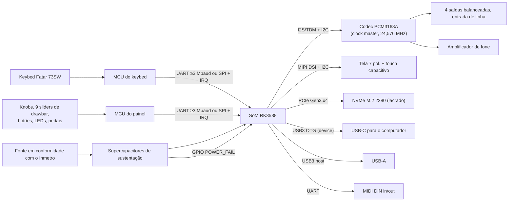

# Interfaces de Hardware: o que o software espera das placas

**Público:** parceiros de hardware que vão construir as placas da v1.

Este documento é o contrato por trás das regras AD-16, AD-17, AD-18, AD-25 e AD-27 do `ARCHITECTURE-SPINE.md`. É a versão em português de `HARDWARE-INTERFACES.md`. Se as duas divergirem, vale a versão em inglês, e a divergência deve ser reportada.

- **"Obrigatório"**: o software depende disso.
- **"Recomendado"**: preferência forte.

## 1. Visão geral do sistema

## 2. SoM e placa

- **SoM industrial** com Rockchip RK3588 e **compromisso escrito de longevidade de 7 a 10 anos**.
  - v1 com 16 GB de RAM, Pro com 32 GB.
  - As duas versões precisam ser compatíveis pino a pino.
- **Sem rádio:** a variante do SoM não tem Wi-Fi nem Bluetooth, e a placa-mãe não tem nenhum componente de RF.
- **Identificação de versão:** um strap (GPIO ou EEPROM) legível no boot, que diferencia v1 de Pro (AD-27).
- **Kernel:** o BSP do SoM precisa suportar o Linux mainline 6.18 LTS. Os caminhos de áudio, USB, PCIe e tela não podem depender só do kernel do fabricante.
- **Térmica:** 24 h em carga máxima de áudio (3 núcleos A76 a 100%) sem throttling, com o gabinete fechado e 40 °C de ambiente.

## 3. MCU do keybed (crítico em tempo)

| Requisito | Valor |
|---|---|
| Escopo | Só as teclas. Nenhuma outra tarefa pode rodar neste MCU |
| Taxa de varredura | ≥10 kHz por contato |
| Contatos | Todos os contatos que o keybed tiver (2 ou 3 por tecla), cada um reportado separadamente. Aftertouch reportado, se existir |
| Timestamp | Contador livre de ≥1 MHz, registrado a cada mudança de contato |
| Velocity | **Não é calculada no MCU.** Ele envia só os tempos crus dos contatos; quem aplica a curva é o SoC (AD-8) |
| Latência | ≤200 µs entre a mudança do contato e o fim do frame no fio |
| Ligação | UART ≥3 Mbaud 8N1, **ou** SPI com o MCU como escravo e uma linha IRQ de "dado pronto" |
| Calibração | Nenhuma no MCU. Curvas e tabelas ficam no SoC |

## 4. MCU do painel

| Elemento | Requisito |
|---|---|
| Knobs | Reportar mudanças de posição com resolução ≥10 bits. Potenciômetro absoluto ou encoder, a definir com o UX |
| 9 sliders de drawbar | ≥10 bits, com debounce, reportados quando mudam, atualização ≥500 Hz |
| Botões | Eventos de pressionar e soltar, com debounce |
| LEDs | Comandados pelo SoC. O MCU nunca muda o estado de um LED por conta própria |
| Pedais | Sustain contínuo (meio-pedal), expressão e 1 switch. ADC ≥10 bits, detecção automática de polaridade no boot, conectores TRS |
| Ligação | A mesma do MCU do keybed, numa UART ou SPI própria |

## 5. Protocolo de frames (os dois MCUs)

| Campo | Tamanho | Observação |
|---|---|---|
| Sync | 1 byte | Fixo, `0xA5` |
| Versão do protocolo | 1 byte | Começa em 1. Aumenta em qualquer mudança incompatível (AD-12) |
| Tipo | 1 byte | Ver a tabela abaixo |
| Tamanho | 1 byte | Bytes do payload |
| Seq | 2 bytes | Incrementa a cada frame. O SoC detecta lacunas |
| Tick | 4 bytes | Tick do MCU no momento do evento |
| Payload | n bytes | |
| CRC-16/CCITT | 2 bytes | Calculado da versão até o fim do payload |

| Tipo | Direção | Payload |
|---|---|---|
| `HELLO` | MCU→SoC | Versão do firmware, versão do protocolo, ID da placa, número de contatos do keybed |
| `KEY_CONTACT` | MCU→SoC | Índice da tecla, índice do contato, fechado/aberto |
| `AFTERTOUCH` | MCU→SoC | Valor por canal ou por tecla (16 bits) |
| `CONTROL` | MCU→SoC | ID do controle e valor de 16 bits (knobs, sliders, pedais) |
| `BUTTON` | MCU→SoC | ID do botão, pressionado/solto |
| `LED_SET` | SoC→MCU | ID do LED, brilho/cor |
| `TIME_SYNC` | SoC→MCU→SoC | O MCU responde com o tick atual, usado para acompanhar o drift |
| `ENTER_BOOTLOADER` | SoC→MCU | Inicia a atualização de firmware |

- Todos os campos de mais de um byte são little-endian.
- Os mapas de IDs de controles e de LEDs ficam com a equipe de software e saem junto com o primeiro firmware.

## 6. Atualização de firmware dos MCUs

- **Bootloader:** cada MCU precisa de um **bootloader imutável com dois bancos de firmware**. Se a energia cair durante a gravação, o banco antigo continua inicializável.
- **Gravação pelo SoC:** o SoC precisa conseguir colocar cada MCU em modo bootloader e gravar o firmware. A gravação pode ser pela mesma ligação ou por um par de GPIOs BOOT/RESET vindo do SoC.
- **Nenhuma gravação de campo por conector externo.**

## 7. Áudio

- **Codec:** TI PCM3168A em TDM, com controle por I2C.
- **Clock:** o codec é o mestre, com cristal próprio de **24,576 MHz**, e o SoC é escravo no I2S/TDM. O PLL do SoC não pode gerar os clocks de áudio (AD-17).
- **Mapa de canais:**
  - DAC 1–2: saída principal L/R.
  - DAC 3–4: saída auxiliar L/R.
  - DAC 5–6: alimentação do fone.
  - ADC 1–2: entrada de linha estéreo.
- **Saídas:** 4 balanceadas em P10 TRS. O amplificador de fone é um estágio próprio.
- **Mute:** uma linha de mute por hardware, controlada pelo SoC. Ela fica em mute desde o power-on até o SoC liberar, para não haver estalo ao ligar ou desligar.
- **Pedido aos parceiros:** os números de latência do codec e o piso de ruído analógico do projeto de referência.

## 8. Tela e touch

- **Painel:** 7" em MIPI DSI.
  - O software tem plano B por HDMI interno, caso o DSI não funcione no kernel mainline.
  - A placa deve prever footprint ou variante para isso.
- **Touch:** capacitivo por I2C, com controlador que tenha **driver no Linux mainline** (por exemplo, as famílias Goodix ou FocalTech). As linhas de interrupção e reset vão para o SoC.
- **Backlight:** dimerizável por PWM, controlado pelo SoC.

## 9. USB

- **USB-C:** porta USB3 OTG do RK3588 em **modo device**. O device tree define o papel de periférico.
  - O software expõe apenas áudio UAC2, MIDI e uma interface de rede para o app de desktop (AD-13).
  - Não é preciso papel de USB-C Power Delivery, a menos que o projeto de energia exija.
- **USB-A:** porta USB3 host do RK3588, com orçamento para fornecer **≥900 mA** a um SSD externo.

## 10. MIDI DIN

- MIDI IN com optoacoplador e MIDI OUT, numa UART dedicada do SoC a 31.250 baud.

## 11. Armazenamento

- **NVMe:** M.2 2280, PCIe Gen3 x4.
  - **Lacrado**, sem acesso pelo usuário.
  - Com dissipador ou thermal pad.
- **Qualificação do SSD:** a equipe de software mede nos SSDs candidatos, antes de aprovar um modelo:
  - a **latência de leitura p99.99** sob carga de streaming;
  - a durabilidade.
- A placa não pode depender de um único modelo de SSD.

## 12. Energia e queda de energia

- **Fonte:** de prateleira, em conformidade com o Inmetro. Segurança elétrica e EMC projetadas segundo a IEC 62368-1, para facilitar CE e FCC no futuro.
- **Sustentação:** os supercapacitores mantêm o sistema inteiro funcionando por **≥150 ms** depois da perda de entrada. Esse tempo cobre o flush do NVMe e o fade do áudio.
- **GPIO `POWER_FAIL`:** sinalizado ao SoC **≥100 ms** antes de os rails caírem. Pedido aos parceiros: o tempo medido.
- **Botão de liga/desliga:** soft, ligado ao SoC. Um toque longo força o desligamento.

## 13. Segurança e fábrica

- **Secure boot:** a estação de fábrica grava as chaves de secure boot na OTP do RK3588. É preciso planejar uma jiga de gravação.
- **JTAG/SWD:** desabilitado ou queimado por fusível no SoC e nos MCUs de produção.
- **UART de debug:** só como conector interno. O firmware de produção a desabilita.
- **Teste de fábrica:** uma imagem assinada de teste verifica em cada unidade:
  - todas as portas;
  - os dois MCUs;
  - os contatos do keybed;
  - o loopback do codec (saída → entrada de linha);
  - tela e touch;
  - o NVMe.
  Para o loopback do codec, a placa deve ter pontos de teste ou uma jiga.
- **Registro de aparelhos:** o número de série de cada unidade é vinculado ao ID do SoM. O número de série deve ser legível em etiqueta e na EEPROM.

## 14. O que precisamos que os parceiros devolvam

1. Fabricante e part number do SoM, mais o compromisso de longevidade por escrito.
2. Número de contatos (2 ou 3) e presença de aftertouch no estoque de keybeds 73SW.
3. Família de MCU escolhida e a abordagem de bootloader para os dois MCUs.
4. Part numbers do painel DSI e do controlador de touch.
5. Tempo medido do `POWER_FAIL` e duração da sustentação.
6. Medições do projeto de referência do codec (latência, ruído).
7. Resultado do teste térmico em carga máxima.
